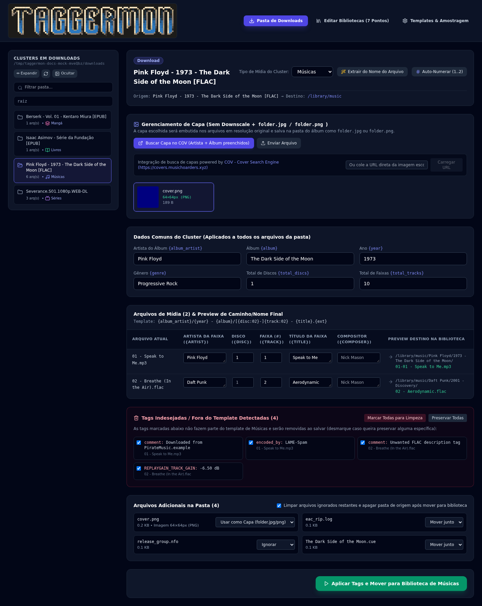
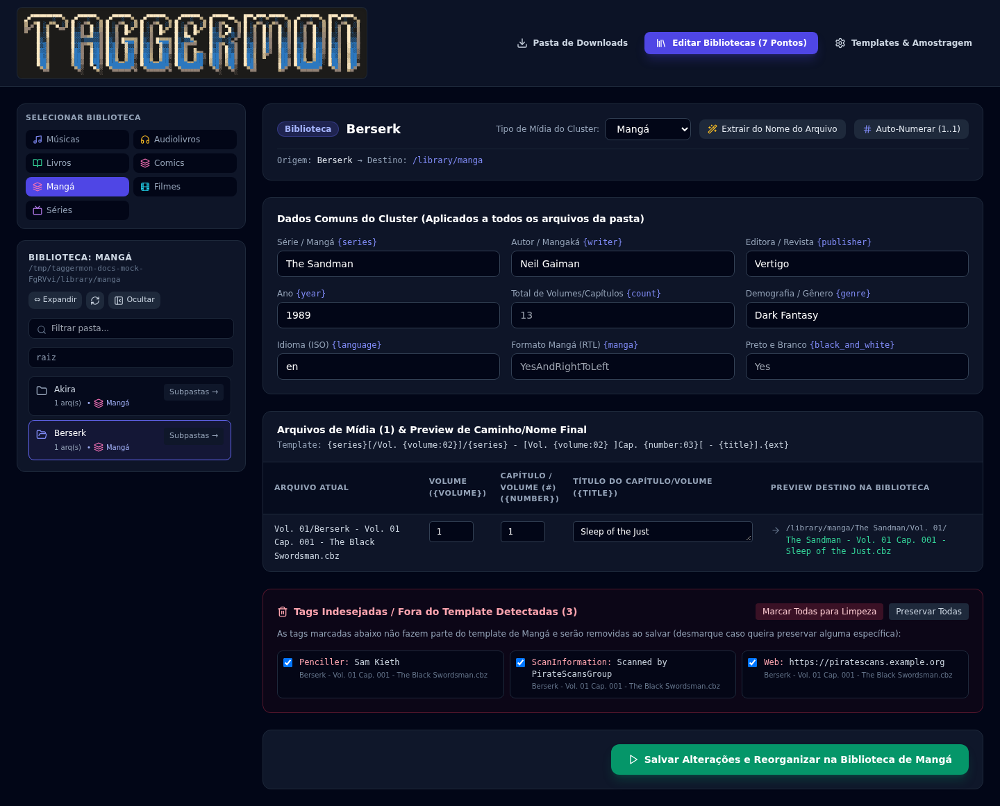

<div align="center">


# Taggermon

**All-Purpose Web Media Tag Editor & Library Organizer**
*Music • Audiobooks • Books • Comics • Manga • Movies • Series*

[](LICENSE)
[](Dockerfile)
[](tsconfig.json)
[](https://github.com/alghostzx/Taggermon/pkgs/container/taggermon)
[](#ai-generated-project-notice)

[Features](#key-features) •
[Visual Tour & Screenshots](#visual-tour--screenshots) •
[Media Rules (7 Types)](#supported-media-types--rules) •
[Formal Module Documentation](docs/ARCHITECTURE.md) •
[Docker Compose Deploy](#deployment-with-docker-compose) •
[Testing](#testing--verification)

</div>

---

## AI-Generated Project Notice

> [!IMPORTANT]
> **This software project is 100% generated by Artificial Intelligence.**
> Every module, architectural decision, backend media processor, React component, SQLite schema, test fixture, and GitHub Actions workflow in **Taggermon** was written end-to-end by **Antigravity AI** (powered by Google DeepMind) under the specification, design review, and direction of **Augusto Pinto ([@alghostzx](https://github.com/alghostzx))**.

---

## Overview

**Taggermon** is a self-hosted web application built with **Node.js 24 + TypeScript + Fastify + React 18 + TailwindCSS + SQLite** designed to take single-media folder clusters from a `/downloads` volume, inspect and clean their internal metadata tags, fetch uncompressed high-resolution album covers via the official **COV — Cover Search Engine (`https://covers.musichoarders.xyz`)** Remote Protocol, convert `.cbr` and `.epub` comics/manga into `.cbz` archives with clean `ComicInfo.xml` metadata, match and rename movie/series subtitle files, and move everything into **7 dedicated library mount points** formatted according to your custom token templates.

It also allows browsing and re-editing files **already inside any of the 7 libraries**, automatically reorganizing their directories and cleaning up old empty folders whenever path tokens change.

---

## Key Features

- **7 Dedicated Media Pipelines**: Music, Audiobooks, Books (`.epub`, `.mobi`, `.pdf`), Comics (`.cbz`, `.cbr`, `.epub`, `.pdf`), Manga (`.cbz`, `.cbr`, `.epub`, `.pdf`), Movies, and Series.
- **Customizable Token Templates with Conditional Blocks**:
  - Define 1 canonical path & filename template per media type using tokens (`{album_artist}`, `{year}`, `{series}`, `{writer}`), numeric zero-padding (`{track:02}`, `{number:03}`), and optional conditional blocks (`[{disc:02}-]`, `[/Vol. {volume:02}]`) that only render when their inner tags are present.
- **Uniform Random Library Sampler & Heuristic Template Discovery**:
  - Sample 40 to 500 random files across an existing library (using **Vitter's Reservoir Sampling + Fisher-Yates shuffle**) to heuristically deduce path/filename templates and discover which tags exist in your collection.
- **Interactive Template Tag Selector & Unwanted Tag Cleaner**:
  - Choose which tags belong to each media type's template (manually or from sampled library files). Any other tags found in downloaded files are highlighted in a dedicated **"Tags Indesejadas / Fora do Template"** panel and stripped on save (unless preserved individually or added to the global whitelist).
- **Official COV (`covers.musichoarders.xyz`) Remote Protocol Integration**:
  - Opens COV in puppet mode (`?remote.port=browser&remote.agent=Taggermon/1.0&artist=...&album=...`) for human cover selection, receives the chosen cover URL via `window.postMessage`, closes the COV tab automatically (`{ type: 'close' }`), downloads the original artwork **with zero downscaling**, embeds it into every audio track, and writes `folder.jpg` or `folder.png` in the album directory.
- **Automatic `.cbr` & `.epub` → `.cbz` Conversion (Spine Reading Order)**:
  - Converts `.cbr` and `.epub` comics/manga into `.cbz`. For `.epub` files, extracts images following the true OPF `<spine>` reading order (not alphabetical filename order), renames pages sequentially (`0001.jpg`, `0002.jpg`, ...), and writes a clean `ComicInfo.xml` at the root.
- **Fast ZIP Central Directory (`EOCD`) Reader**:
  - Reads `ComicInfo.xml` from 60 MB–300 MB `.cbz` archives in ~15 ms by seeking directly to the ZIP Central Directory without loading image streams into memory.
- **Lossless Video Container Tag Stripping & Subtitle Renaming**:
  - Strips embedded release-group titles/comments from `.mkv` (via `mkvpropedit` in-place) and `.mp4` (via `ffmpeg -map_metadata -1`), and auto-associates subtitles in the root or `Subs/` folder, renaming them as `<video_name>[.<lang>][.sdh][.forced].<ext>`.
- **Zero Text Truncation & Collapsible Sidebars**:
  - Every filename, relative path, and destination preview wraps cleanly across multiple lines without `...` ellipsis truncation. All three main views (Downloads Explorer, Library Browser, and Template Sampling) feature collapsible/expandable sidebars (open by default).

---

## Visual Tour & Screenshots

### 1. Downloads Cluster Editor — Music, COV Artwork, Unwanted Tags & Extra Files
Inspect audio tracks, preview folder images with exact dimensions/size, launch **COV (`covers.musichoarders.xyz`)** with pre-filled Artist & Album, strip unwanted tags (`comment`, `encoded_by`), and assign actions (`Mover junto`, `Usar como Capa`, `Ignorar`, `Excluir`) to extra files (`.cue`, `.log`, `.nfo`, scans):



---

### 2. Downloads Cluster Editor — Series & Movies with Subtitle Language/Flag Matcher
For Movies and Series, internal tag editing is dispensed in favor of a container tag cleanup toggle (*"Limpar tags internas do container via ffmpeg/mkvpropedit"*, enabled by default) and automatic subtitle association (`SxxExx`), language detection (`pt-BR`, `en`), and flag tagging (`.forced`, `.sdh`):


---

### 3. Library Browser — Edit & Reorganize Existing Libraries (7 Mount Points)
Navigate any of the 7 mounted libraries on demand, edit tags or path tokens, convert formats, and automatically clean up old empty folders when paths change:



---

### 4. Template Manager & Uniform Random Library Sampling
Configure the path and filename template for each media type, select or add template tags, manage the global extra-tag whitelist, and sample random files from your existing library (with a `+ Aumentar Amostra (+40)` button to expand the search zone up to 500 files):


---

## Supported Media Types & Rules

| Media Type | Container Mount Point | Internal Tagging Behavior | Format Conversion, Covers & Accompanying Files |
| :--- | :--- | :--- | :--- |
| **1. Music** (`music`) | `/library/music` | Reads/writes template audio tags (`.mp3`, `.flac`, `.m4a`, `.ogg`, `.opus`, `.wav`, `.aac`) and strips non-template tags. | Official **COV (`covers.musichoarders.xyz`)** browser Remote Protocol integration, local image preview (dimensions/format/size), **zero-downscale** embedded cover + `folder.jpg`/`folder.png`, and per-file actions for `.cue`, `.log`, `.nfo`, and extra scans. |
| **2. Audiobooks** (`audiobooks`) | `/library/audiobooks` | Supports multi-file chapters (`.mp3`, `.m4a`, `.flac`) and single-file (`.m4b`) with `{author}`, `{narrator}`, `{series}`, `{series_part}`, `{book_title}`, `{year}`, `{track}`, `{title}`. | **Zero-downscale** embedded cover + `folder.jpg`/`folder.png` in destination folder, COV integration, and extra file management. |
| **3. Books** (`books`) | `/library/books` | For `.epub`: edits internal OPF XML (`content.opf`) and cleans non-template metadata. For `.mobi`/`.azw3`: uses Calibre `ebook-meta` or converts to `.epub`. For `.pdf`: **dispenses internal tags**. | Supports embedding/replacing book cover in `.epub`/`.mobi`. For `.pdf`, strictly formats destination folder and filename. |
| **4. Comics** (`comics`) | `/library/comics` | Reads/writes clean `ComicInfo.xml` at the root of `.cbz` archives and strips non-template XML nodes. For `.pdf`: **dispenses internal tags**. | **Automatic `.cbr` and `.epub` → `.cbz` conversion** (extracting `.epub` pages in `<spine>` reading order as `0001.jpg`, `0002.jpg`, ...). |
| **5. Manga** (`manga`) | `/library/manga` | Reads/writes clean `ComicInfo.xml` inside `.cbz` (including `<Series>`, `<Writer>`, `<Volume>`, `<Number>`, `<Count>`, `<Manga>`, `<BlackAndWhite>`). For `.pdf`: **dispenses internal tags**. | **Automatic `.cbr` and `.epub` → `.cbz` conversion** following `<spine>` reading order + fast ZIP Central Directory (`EOCD`) inspection. |
| **6. Movies** (`movies`) | `/library/movies` | **No tag editing**. Includes toggle (enabled by default) to strip container metadata via `mkvpropedit` / `ffmpeg`. | Auto-matches subtitles (`.srt`, `.ass`, `.ssa`, `.sub`, `.idx`, `.vtt`) in root or `Subs/`, detecting language/flags and renaming to `<movie_name>[.<lang>][.sdh][.forced].<ext>`. |
| **7. Series** (`series`) | `/library/series` | **No tag editing**. Includes toggle (enabled by default) to strip container metadata via `mkvpropedit` / `ffmpeg`. | Auto-matches subtitles to episodes (`SxxExx`), allowing language/flag edits in the UI and renaming alongside each episode. |

---

## Architecture & Module Summary

> For full technical specifications of every module, function, REST route, and algorithm, see **[docs/ARCHITECTURE.md](docs/ARCHITECTURE.md)**.

| Module Path | Responsibility |
| :--- | :--- |
| [`src/shared/types.ts`](src/shared/types.ts) | Canonical TypeScript interfaces shared across Fastify backend and React SPA. |
| [`src/shared/constants.ts`](src/shared/constants.ts) | Media type definitions, default templates, mount env vars, and available tag schemas. |
| [`src/server/config.ts`](src/server/config.ts) | Volume mount path resolution for `/config`, `/downloads`, and the 7 `/library/*` mounts. |
| [`src/server/db.ts`](src/server/db.ts) | SQLite (`better-sqlite3` WAL) schema setup, default seeding, and template persistence. |
| [`src/server/templateEngine.ts`](src/server/templateEngine.ts) | Token renderer (`{track:02}`), nested conditional blocks (`[...]`), reverse filename parser, heuristic template deducer, and **Vitter's Reservoir Sampler**. |
| [`src/server/scanner.ts`](src/server/scanner.ts) | Safe path traversal guard, folder cluster lister, heuristic media type classifier, and deep cluster inspector. |
| [`src/server/routes.ts`](src/server/routes.ts) | Fastify REST API (11 endpoints), COV artwork proxy, library suggestion aggregator, and batch cluster processor. |
| [`src/server/processors/audioProcessor.ts`](src/server/processors/audioProcessor.ts) | `ffprobe`/`ffmpeg` audio tag inspector, unwanted tag stripper, lossless cover embedder, and `folder.jpg`/`folder.png` writer. |
| [`src/server/processors/comicProcessor.ts`](src/server/processors/comicProcessor.ts) | Fast ZIP Central Directory (`EOCD`) `ComicInfo.xml` reader, clean XML builder, and `.cbr`/`.epub` (`<spine>`-ordered) to `.cbz` converter. |
| [`src/server/processors/bookProcessor.ts`](src/server/processors/bookProcessor.ts) | `.epub` `content.opf` XML metadata & cover editor, Calibre `.mobi` CLI handler, and `.pdf` path organizer. |
| [`src/server/processors/videoProcessor.ts`](src/server/processors/videoProcessor.ts) | `.mkv` (`mkvpropedit`) and `.mp4` (`ffmpeg`) container metadata stripper and subtitle language/flag matcher. |
| [`src/client/App.tsx`](src/client/App.tsx) | Main React shell with top navigation and independent collapsible sidebars for Downloads and 7 Libraries. |
| [`src/client/components/TaggermonLogo.tsx`](src/client/components/TaggermonLogo.tsx) | 12-line ANSI art logo generated from `~/logo.sh` using the **Srcery** color palette. |
| [`src/client/components/ClusterEditor.tsx`](src/client/components/ClusterEditor.tsx) | Interactive cluster tag/path editor with batch fill, auto-numbering, pattern extraction, unwanted tag cleaner, extra files manager, and subtitle editor. |
| [`src/client/components/CoverSection.tsx`](src/client/components/CoverSection.tsx) | Cover art manager with folder image quality previews and official **COV (`covers.musichoarders.xyz`)** browser Remote Protocol handshake. |
| [`src/client/components/TemplateManager.tsx`](src/client/components/TemplateManager.tsx) | Template editor, interactive tag checklist, custom tag input, whitelist manager, and collapsible random library sampler. |

---

## Deployment with Docker Compose

Taggermon is published automatically to the GitHub Container Registry (`ghcr.io/alghostzx/taggermon:latest`) via GitHub Actions on every push to `main`.

```yaml
services:
  taggermon:
    image: ghcr.io/alghostzx/taggermon:latest
    container_name: taggermon
    restart: unless-stopped
    ports:
      - "3000:3000"
    environment:
      - PORT=3000
      - HOST=0.0.0.0
      - CONFIG_DIR=/config
      - DOWNLOADS_DIR=/downloads
      - LIBRARY_MUSIC_DIR=/library/music
      - LIBRARY_AUDIOBOOKS_DIR=/library/audiobooks
      - LIBRARY_BOOKS_DIR=/library/books
      - LIBRARY_COMICS_DIR=/library/comics
      - LIBRARY_MANGA_DIR=/library/manga
      - LIBRARY_MOVIES_DIR=/library/movies
      - LIBRARY_SERIES_DIR=/library/series
    volumes:
      - /path/to/config:/config
      - /path/to/downloads:/downloads
      - /path/to/music:/library/music
      - /path/to/audiobooks:/library/audiobooks
      - /path/to/books:/library/books
      - /path/to/comics:/library/comics
      - /path/to/manga:/library/manga
      - /path/to/movies:/library/movies
      - /path/to/series:/library/series
```

Start the container:
```bash
docker compose up -d
```
Then open **`http://localhost:3000`** in your browser.

---

## Local Development & Testing

### Prerequisites
- **Node.js 24 LTS** (or 22+)
- System packages for media processing: `ffmpeg`, `mkvtoolnix` (`mkvpropedit`), `unrar-free` / `p7zip-full`, and optionally `calibre-bin` (`ebook-meta`, `ebook-convert`).

### Commands
```bash
# Install dependencies
npm install

# Run backend and frontend in development mode
npm run dev:server
npm run dev:client

# Type-check both frontend and backend
npm run typecheck

# Run the complete unit, media integration, API, and React UI test suite (33 tests)
npm test

# Run test suite with V8 code coverage report
npm run test:coverage

# Build production bundle (dist/client + dist/server)
npm run build
```

---

## Credits & Acknowledgments

- **Artwork Search Integration**: Powered by **[COV — Cover Search Engine](https://covers.musichoarders.xyz)** (`https://covers.musichoarders.xyz`) using its official browser Remote Protocol (`remote.port=browser`).
- **Color Palette**: Logo styled with the **[Srcery](https://srcery-colors.github.io/)** color scheme.
- **AI Engineering**: Entirely generated by **Antigravity AI** (Google DeepMind) for **Augusto Pinto ([@alghostzx](https://github.com/alghostzx))**.

---

## License

Released under the **[MIT License](LICENSE)**.
