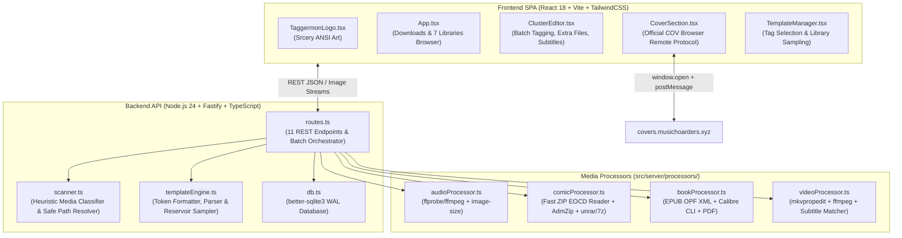

# Taggermon — Formal Architecture & Module Reference

> **AI-Generated Software Notice**
> **Taggermon** was **100% architected, implemented, tested, and documented by Artificial Intelligence** (Antigravity, powered by Google DeepMind) through an interactive specification and verification workflow directed by **Augusto Pinto (`@alghostzx`)**. Every line of TypeScript, React UI, SQLite schema, media processor, test fixture, and CI/CD pipeline was synthesized by AI.

---

## Table of Contents

1. [System Overview](#1-system-overview)
2. [Directory & Module Structure](#2-directory--module-structure)
3. [Shared Domain Layer (`src/shared/`)](#3-shared-domain-layer-srcshared)
4. [Backend Core Layer (`src/server/`)](#4-backend-core-layer-srcserver)
   - [4.1 Configuration & Mount Resolution (`config.ts`)](#41-configuration--mount-resolution-configts)
   - [4.2 SQLite Persistence Layer (`db.ts`)](#42-sqlite-persistence-layer-dbts)
   - [4.3 Template & Heuristic Discovery Engine (`templateEngine.ts`)](#43-template--heuristic-discovery-engine-templateenginets)
   - [4.4 Cluster Scanner & Heuristic Classifier (`scanner.ts`)](#44-cluster-scanner--heuristic-classifier-scannerts)
   - [4.5 Fastify REST API & Orchestrator (`routes.ts` & `index.ts`)](#45-fastify-rest-api--orchestrator-routests--indexts)
5. [Media Processors (`src/server/processors/`)](#5-media-processors-srcserverprocessors)
   - [5.1 Audio & Audiobook Processor (`audioProcessor.ts`)](#51-audio--audiobook-processor-audioprocessorts)
   - [5.2 Comic & Manga Processor (`comicProcessor.ts`)](#52-comic--manga-processor-comicprocessorts)
   - [5.3 Book Processor (`bookProcessor.ts`)](#53-book-processor-bookprocessorts)
   - [5.4 Video & Subtitle Processor (`videoProcessor.ts`)](#54-video--subtitle-processor-videoprocessorts)
6. [Frontend Web Application (`src/client/`)](#6-frontend-web-application-srcclient)
   - [6.1 Main Shell & Collapsible Navigators (`App.tsx`)](#61-main-shell--collapsible-navigators-apptsx)
   - [6.2 Cluster Tag & Path Editor (`ClusterEditor.tsx`)](#62-cluster-tag--path-editor-clustereditortsx)
   - [6.3 Cover Artwork & Official COV Remote Protocol (`CoverSection.tsx`)](#63-cover-artwork--official-cov-remote-protocol-coversectiontsx)
   - [6.4 Template Manager & Random Sampler UI (`TemplateManager.tsx`)](#64-template-manager--random-sampler-ui-templatemanagertsx)
   - [6.5 Srcery ANSI Art Logo (`TaggermonLogo.tsx`)](#65-srcery-ansi-art-logo-taggermonlogotsx)
7. [Automated Test Suite (`tests/`)](#7-automated-test-suite-tests)

---

## 1. System Overview

Taggermon runs as a **single monolithic container** serving both the compiled React SPA and the Fastify REST API on port `3000`. It mounts a `/config` volume (for SQLite persistence), a `/downloads` volume (incoming clusters), and **7 dedicated library volumes** (`/library/music`, `/library/audiobooks`, `/library/books`, `/library/comics`, `/library/manga`, `/library/movies`, `/library/series`).



---

## 2. Directory & Module Structure

```text
Taggermon/
├── .github/workflows/
│   └── docker-publish.yml       # CI/CD pipeline: typecheck, Vitest suite, Buildx -> ghcr.io
├── docs/
│   ├── ARCHITECTURE.md          # Formal technical documentation of all modules
│   └── assets/                  # Mocked Chromium Headless screenshots & Srcery logo
├── src/
│   ├── shared/
│   │   ├── types.ts             # Shared TypeScript interfaces across backend & frontend
│   │   └── constants.ts         # Metadata, default templates, and tag definitions for all 7 media types
│   ├── server/
│   │   ├── index.ts             # Fastify server bootstrap & static SPA hosting
│   │   ├── config.ts            # Environment variable & volume mount path resolution
│   │   ├── db.ts                # SQLite schema initialization, seeding, and template CRUD
│   │   ├── templateEngine.ts    # Token renderer, conditional blocks, reverse parser, Reservoir Sampler
│   │   ├── scanner.ts           # Directory cluster scanner, heuristic media detector, path traversal guard
│   │   ├── routes.ts            # Fastify REST endpoints & end-to-end cluster processing pipeline
│   │   └── processors/
│   │       ├── audioProcessor.ts  # Music & Audiobook tagger, cover embedder, folder.jpg/png writer
│   │       ├── comicProcessor.ts  # CBZ ComicInfo.xml editor, fast EOCD reader, CBR/EPUB->CBZ converter
│   │       ├── bookProcessor.ts   # EPUB OPF metadata/cover editor, MOBI handler, PDF organizer
│   │       └── videoProcessor.ts  # MKV/MP4 container tag stripper & subtitle language/flag matcher
│   └── client/
│       ├── index.html           # HTML entry point
│       ├── main.tsx             # React 18 root mount
│       ├── App.tsx              # Top navigation & collapsible folder explorers
│       └── components/
│           ├── TaggermonLogo.tsx  # ANSI art logo generated from ~/logo.sh with Srcery palette
│           ├── ClusterEditor.tsx  # Interactive cluster tag/path/subtitle/extras editor
│           ├── CoverSection.tsx   # Cover previewer & official COV Remote Protocol integration
│           └── TemplateManager.tsx# Template editor, tag selector, and random library sampler
├── tests/
│   ├── fixtures/                # Real versioned media fixtures (.mp3, .flac, .m4a, .m4b, .ogg, .cbz, .cbr, .epub, .mobi, .pdf, .mkv, .mp4, .srt, .ass)
│   ├── test-helpers.ts          # Isolated temporary workspace factory
│   ├── unit/                    # Unit tests for templateEngine and SQLite db
│   ├── integration/             # Integration tests for audio, comics, books, video, and Fastify API
│   └── ui/                      # React Testing Library + JSDOM component & COV protocol tests
├── Dockerfile                   # Multi-stage Node.js 24 Bookworm image with ffmpeg, mkvtoolnix, unrar, p7zip, calibre
├── docker-compose.yml           # Compose definition with all 9 mount points (/config, /downloads, 7 libraries)
└── LICENSE                      # MIT License
```

---

## 3. Shared Domain Layer (`src/shared/`)

- **`src/shared/types.ts`**:
  Defines the canonical data structures shared between the Fastify backend and React frontend:
  - `MediaType`: Union of `'music' | 'audiobooks' | 'books' | 'comics' | 'manga' | 'movies' | 'series'`.
  - `MediaTemplate`: Represents each media type's single configurable template (`pathTemplate`, `filenameTemplate`, `requiredTags`, `whitelistedExtraTags`, `stripContainerTagsByDefault`).
  - `ClusterScanResult`: Returned when inspecting a folder in `/downloads` or any `/library/*`, containing `mediaFiles`, `extraFiles` (with image resolution/format), and matched `subtitles`.
  - `TemplateSuggestion` & `DiscoveredTagSuggestion`: Ranked template candidates and tag frequency statistics produced by random library sampling.
- **`src/shared/constants.ts`**:
  Exports `MEDIA_TYPES_CONFIG` and `ALL_MEDIA_TYPES`, defining for each of the 7 media types its default mount path, environment variable name, supported capabilities (`supportsInternalTags`, `supportsCover`, `supportsCOV`, `supportsSubtitles`, `supportsTagCleaningOnly`), default path/filename templates, and available cluster-level vs. file-level tag definitions.

---

## 4. Backend Core Layer (`src/server/`)

### 4.1 Configuration & Mount Resolution (`config.ts`)
Resolves the 9 volume mount points from environment variables (`CONFIG_DIR`, `DOWNLOADS_DIR`, `LIBRARY_MUSIC_DIR`, `LIBRARY_AUDIOBOOKS_DIR`, `LIBRARY_BOOKS_DIR`, `LIBRARY_COMICS_DIR`, `LIBRARY_MANGA_DIR`, `LIBRARY_MOVIES_DIR`, `LIBRARY_SERIES_DIR`) with sensible local fallbacks under `./data/`.

### 4.2 SQLite Persistence Layer (`db.ts`)
Manages the SQLite database (`/config/taggermon.db`) using `better-sqlite3` in WAL (`Write-Ahead Logging`) mode:
- Automatically creates the `media_templates` table on startup and seeds the 7 media templates if not yet present.
- Provides `getAllTemplates()`, `getTemplateByMediaType()`, `updateTemplate()`, and `extractTokensFromTemplateString()`.
- Ensures any token referenced in `pathTemplate` or `filenameTemplate` is automatically merged into `requiredTags`.

### 4.3 Template & Heuristic Discovery Engine (`templateEngine.ts`)
Implements four core algorithms:
1. **Token & Conditional Block Renderer (`renderTemplate`, `formatDestinationRelativePath`)**:
   - Evaluates `{token}` and zero-padded `{token:02}` / `{token:03}` expressions.
   - Evaluates nested conditional blocks `[...]`: an optional block is rendered if and only if every token inside it resolves to a non-empty value.
   - Sanitizes path segments (`sanitizeSegment`) by replacing filesystem-forbidden characters (`<>:"/\|?*`) while preserving accents, spaces, and standard punctuation.
2. **Reverse Pattern Parser (`parseTagsFromPattern`)**:
   - Compiles a user token pattern (e.g., `[{disc:02}-]{track:02} - {title}`) into a named-capture-group regular expression (`RegExp`) and extracts tag values from existing filenames or relative paths.
3. **Uniform Random Library Sampler (`sampleFilesFromLibrary`)**:
   - Traverses a library mount point using **Fisher-Yates directory shuffling** combined with **Vitter's Reservoir Sampling (Algorithm R)** so that every eligible media file across the entire library has an equal `maxFiles / N` probability of being sampled, rather than taking the first sequential files.
4. **Heuristic Template Deduction (`deduceTemplateFromSample`, `aggregateTemplateSuggestions`)**:
   - Cross-references internal tags read from sampled files with their directory segments and filenames (prioritizing specific tags such as `{series}` + `{number:02}` over composite `{title}` strings in Manga/Comics) and falls back to structural regex recognition (`S01E02`, `Season 01`, `(1982)`, `Vol. 01`, `Cap. 001`) to rank template suggestions by confidence.

### 4.4 Cluster Scanner & Heuristic Classifier (`scanner.ts`)
- **Path Traversal Guard (`resolveSafePath`)**: Validates that every requested relative path resolves strictly inside its designated root volume, blocking `../` traversal attacks.
- **Heuristic Media Type Classifier (`detectMediaTypeHeuristic`)**: Inspects file extensions and folder naming patterns to auto-suggest whether a download cluster is `music`, `audiobooks`, `books`, `comics`, `manga`, `movies`, or `series`.
- **Deep Cluster Inspector (`scanClusterFolder`)**: Reads internal tags and unwanted tags for every media file in a folder, measures image dimensions (`imageWidth`, `imageHeight`, `imageFormat`) for extra image files, assigns default extra-file actions (`use_as_cover` for primary cover images, `move` for `.cue`/`.log`, `ignore` for `.nfo`), and matches subtitles to video files.

### 4.5 Fastify REST API & Orchestrator (`routes.ts` & `index.ts`)
Exposes 11 REST endpoints under `/api`:
- `GET /api/config` — Returns media type definitions, mount paths, and all 7 templates.
- `GET /api/templates` & `PUT /api/templates/:mediaType` — Reads or updates a media type's template, active required tags, and whitelist.
- `GET /api/templates/:mediaType/suggestions?maxSamples=N` — Samples `N` random files from the target library and returns ranked `suggestions` plus `discoveredTags` with frequency percentages and sample values.
- `GET /api/folders` — Lists folder clusters inside `/downloads` or any of the 7 libraries.
- `GET /api/cluster` — Performs a deep scan of a selected cluster folder.
- `GET /api/preview-image` — Streams local folder images or extracts embedded audio cover art on the fly.
- `POST /api/cov/inspect-url` — Downloads and inspects high-resolution cover artwork selected via COV without downscaling.
- `POST /api/parse-pattern` — Batch-extracts tags from filenames using a token pattern.
- `POST /api/preview-destinations` — Computes live destination path previews for all files in the editor.
- `POST /api/process-cluster` — Executes the full tagging, tag cleaning, format conversion (`.cbr`/`.epub` → `.cbz`), cover embedding, `folder.jpg`/`folder.png` writing, subtitle renaming, extra file handling, and directory cleanup.

---

## 5. Media Processors (`src/server/processors/`)

### 5.1 Audio & Audiobook Processor (`audioProcessor.ts`)
- Uses `ffprobe` to read container and stream tags from `.mp3`, `.flac`, `.m4a`, `.m4b`, `.ogg`, `.opus`, `.wav`, and `.aac`.
- Normalizes format-specific tag keys (ID3v2, Vorbis Comments, MP4 atoms) into template keys (`album_artist`, `artist`, `album`, `year`, `genre`, `disc`, `total_discs`, `track`, `total_tracks`, `title`, `composer` for Music; `author`, `narrator`, `book_title`, `series`, `series_part`, `year`, `genre`, `language`, `track`, `total_tracks`, `title` for Audiobooks).
- Flags any tag outside the template's `requiredTags` (and not in `whitelistedExtraTags`) as an `unwantedTag`.
- Uses `ffmpeg -map_metadata -1` with stream copy (`-c:a copy -c:v copy`) to strip unwanted metadata and embed cover art at **100% original resolution (zero downscale)**, plus writes an exact binary copy as `folder.jpg` or `folder.png` in the destination folder.

### 5.2 Comic & Manga Processor (`comicProcessor.ts`)
- **Fast ZIP Central Directory Reader (`readSingleFileFromZipFast`)**: Reads only the last 64 KB (*End of Central Directory*) of large `.cbz` archives (60 MB–300 MB) and seeks directly to `ComicInfo.xml`, inspecting 40+ real manga archives in under 1 second without loading image pages into RAM.
- **Clean `ComicInfo.xml` Writer**: Parses and builds `ComicInfo.xml` supporting `Series`, `Publisher`, `Writer`, `Penciller`, `Year`, `Volume`, `Number`, `Count`, `Title`, `Genre`, `LanguageISO`, `Manga`, `BlackAndWhite`, and `PageCount`, removing all non-template fields unless explicitly preserved.
- **Automatic `.cbr` & `.epub` → `.cbz` Conversion**:
  - For `.epub`: parses `META-INF/container.xml` and the OPF `<spine>` / `<manifest>` + XHTML `` references to extract page images in **true reading order** (rather than alphabetical filename order), renaming them sequentially (`0001.jpg`, `0002.jpg`, ...) at the root of the new `.cbz` alongside `ComicInfo.xml`.
  - For `.cbr`: extracts RAR/ZIP archives via `unrar` / `7z` / `node-unrar-js` and repackages sequentially into `.cbz` with `ComicInfo.xml`.
  - For `.pdf`: skips internal tag modification and organizes the folder path and filename according to the template.

### 5.3 Book Processor (`bookProcessor.ts`)
- For `.epub`: directly parses and rebuilds the internal OPF XML (`content.opf`), updating Dublin Core (`dc:title`, `dc:creator`, `dc:publisher`, `dc:date`, `dc:language`, `dc:subject`, `dc:identifier` ISBN) and Calibre series metadata (`calibre:series`, `calibre:series_index`), stripping unwanted metadata nodes, and optionally embedding/replacing the cover image in the manifest.
- For `.mobi` / `.azw3`: reads/writes metadata via Calibre's `ebook-meta` CLI or optionally converts `.mobi` to `.epub` via `ebook-convert`.
- For `.pdf`: dispenses internal tags and organizes path and filename only.

### 5.4 Video & Subtitle Processor (`videoProcessor.ts`)
- Designed for **Movies** and **Series**, where tag editing is dispensed in favor of container cleanup and path/filename formatting.
- **Container Tag Stripper**: When the toggle *"Limpar tags internas do container (via ffmpeg/mkvpropedit)"* is active (on by default), strips release-group titles and comments in-place via `mkvpropedit` for `.mkv` files or lossless stream copy (`ffmpeg -map 0 -c copy -map_metadata -1`) for `.mp4` and other containers.
- **Subtitle Language & Flag Matcher**: Detects accompanying `.srt`, `.ass`, `.ssa`, `.sub`, `.idx`, and `.vtt` files in the cluster root or `Subs/` subfolder, pairs them to their corresponding video (by `SxxExx` episode marker or base filename), extracts language codes (`pt-BR`, `en`, `es`, `ja`, etc.) and flags (`.forced`, `.sdh`), and renames/moves them alongside the destination video as `<video_name>[.<lang>][.sdh][.forced].<ext>`.

---

## 6. Frontend Web Application (`src/client/`)

- **`App.tsx`**: Top navigation bar and main workspace layout featuring independent **collapsible and expandable sidebars** (open by default) for the Downloads Explorer and the 7-Library Browser.
- **`ClusterEditor.tsx`**: Full multiline word-wrapped editor (zero text truncation) with cluster-level batch fields, auto-expanding multiline per-file inputs, two-line destination path preview (folder path + highlighted filename), filename pattern extraction tool, sequential auto-numbering (`1..N`), unwanted tag checklist, extra file action selectors (`Mover junto`, `Usar como Capa`, `Ignorar`, `Excluir`), and subtitle language/flag controls.
- **`CoverSection.tsx`**: Displays folder image previews with resolution (`width × height`), format, and byte size, local image upload, and official integration with **COV - Cover Search Engine (`https://covers.musichoarders.xyz`)** using its documented browser Remote Protocol (`?remote.port=browser&remote.agent=Taggermon/1.0&artist=...&album=...` + `window.addEventListener('message')` + automatic `{ type: 'close' }`).
- **`TemplateManager.tsx`**: Interactive template builder for all 7 media types with token insertion buttons (`+Pasta`, `+Arq`), checkboxes to select/deselect which tags belong to the template, manual custom tag addition, global extra-tag whitelist, and the collapsible **Random Library Sampling** panel with adjustable sample size (`40` to `500` files and `+ Aumentar Amostra (+40)` button).
- **`TaggermonLogo.tsx`**: Renders the 12-line ANSI block-art logo from `~/logo.sh` styled with the official **Srcery** color palette (`#1C1B19`, `#2C78BF`, `#BAA67F`, `#918175`, `#FCE8C3`).

---

## 7. Automated Test Suite (`tests/`)

The test suite uses **Vitest** and **React Testing Library** against **versioned binary media fixtures** in `tests/fixtures/`:
- `tests/unit/templateEngine.test.ts` — Token formatting, nested conditional blocks, reverse filename parsing, heuristic deduction across all 7 media types, and uniform random Reservoir Sampling verification.
- `tests/unit/db.test.ts` — SQLite WAL initialization, template seeding, token extraction, and CRUD persistence.
- `tests/integration/audio.test.ts` — Real `.mp3`, `.flac`, `.m4a`, `.m4b`, and `.ogg` inspection, unwanted tag stripping, whitelist preservation, high-res cover embedding/extraction without downscale, and `folder.png`/`folder.jpg` generation.
- `tests/integration/comics.test.ts` — Fast `.cbz` `ComicInfo.xml` reading/writing, `.cbr` → `.cbz` conversion, `.epub` `<spine>` reading-order extraction to `.cbz`, and `.pdf` path-only organization.
- `tests/integration/books.test.ts` — `.epub` `content.opf` editing and cover embedding, `.mobi` and `.pdf` handling.
- `tests/integration/video.test.ts` — `.mkv` and `.mp4` container tag stripping, subtitle language/flag detection, and episode matching.
- `tests/integration/api.test.ts` — All 11 Fastify routes, local HTTP COV image proxy verification, library reorganization with empty folder cleanup, and path traversal (`../`) security tests.
- `tests/ui/app.test.tsx` — End-to-end JSDOM tests covering Downloads, 7 Libraries, collapsible sidebars, COV `postMessage` handshake, and Template Sampling.
